# Ayran — Modelagem UML

Diagramas do protótipo, em Mermaid (o GitHub e o VS Code com a extensão Mermaid exibem desenhado).
Fonte de verdade das decisões: [REQUIREMENTS.md](../REQUIREMENTS.md). O código manda: se algo divergir, corrija o diagrama.

Legenda de estado: **real** = funciona com dados reais; **exemplo** = usa dados de demonstração, marcados na tela.

## 1. Casos de uso

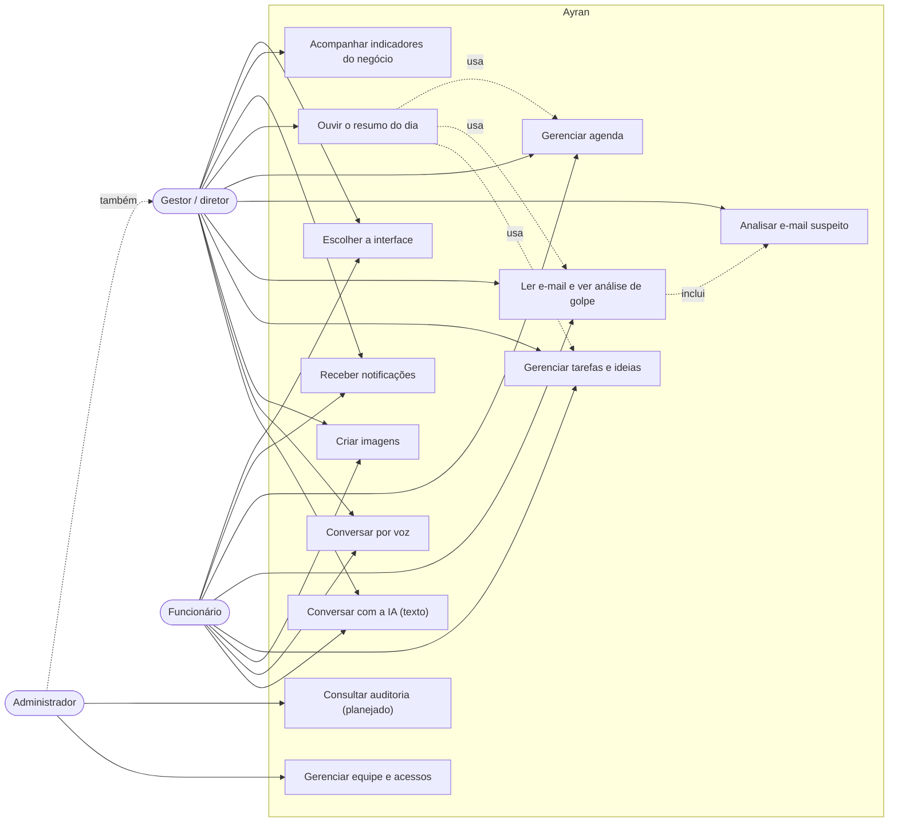

## 2. Componentes

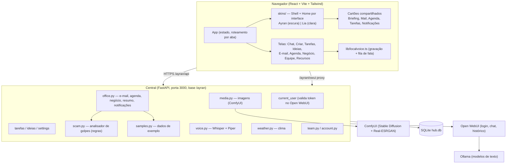

## 3. Modelo de domínio (classes)

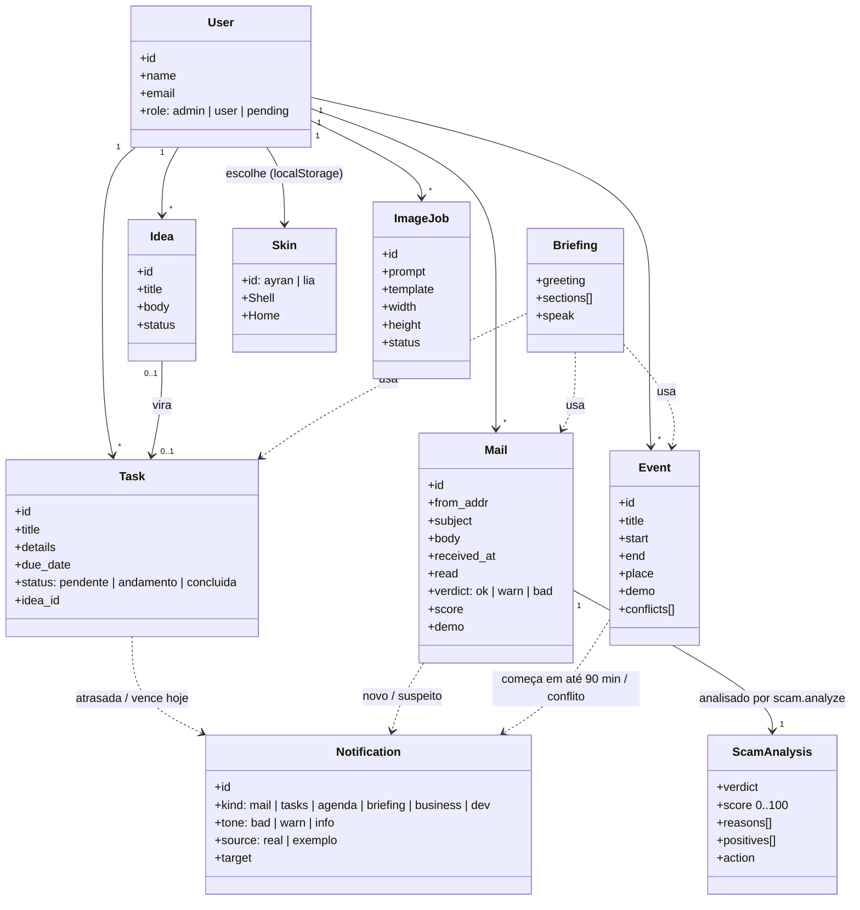

## 4. Banco de dados (ER)

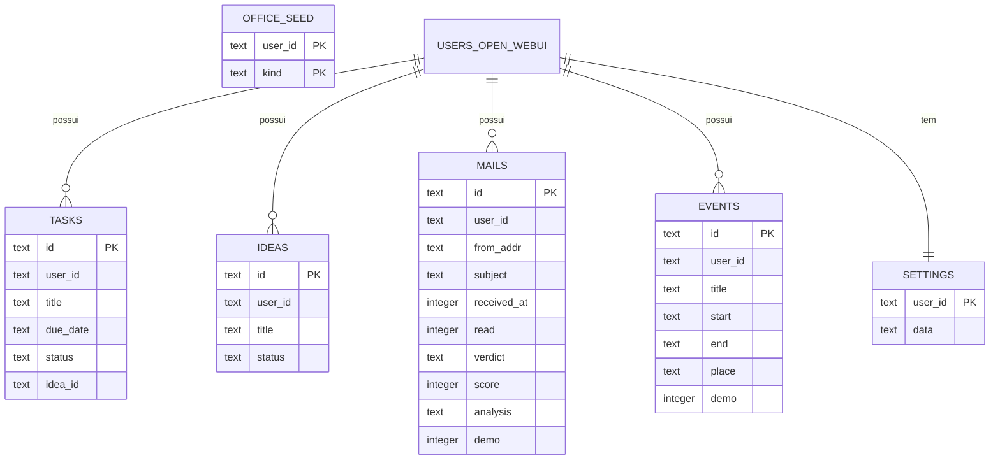

As contas ficam no Open WebUI; a Central guarda só o `user_id`. Ao **excluir** uma conta, `purge_user_data` apaga os dados dela; ao suspender, nada é apagado.

## 5. Sequência — chegada de e-mail e análise de golpe

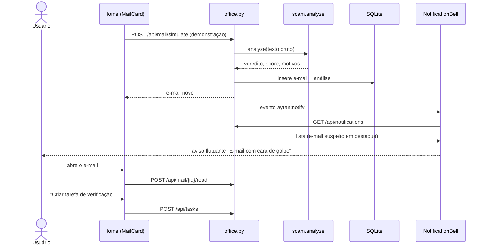

Com o Microsoft 365 / Gmail conectado, só a origem das mensagens (`simulate`) é trocada por um provedor real (Graph API / Gmail API); análise, notificações e telas não mudam.

## 6. Sequência — conversa por voz

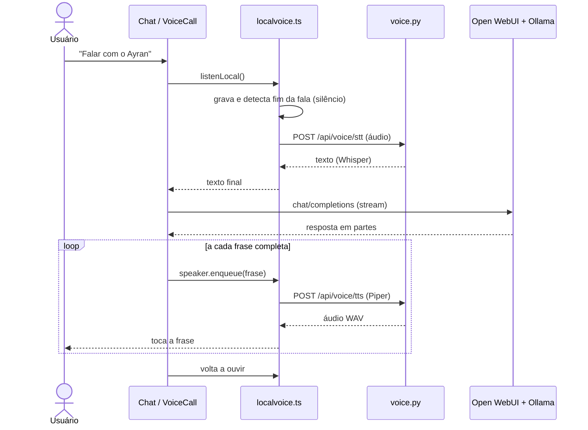

## 7. Sequência — resumo do dia para o diretor

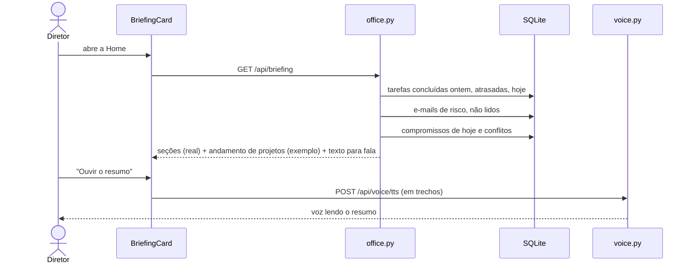

## 8. Estados

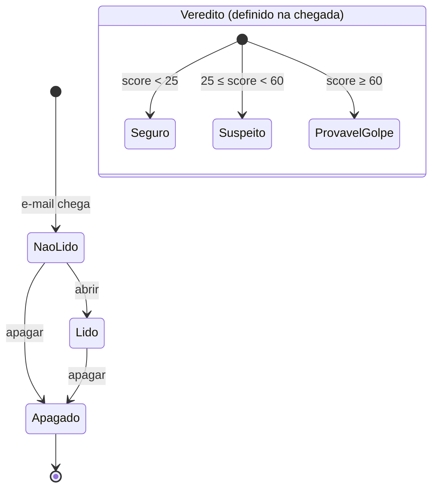

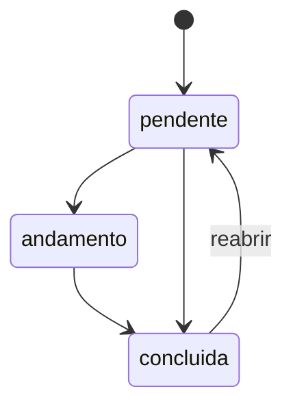

## 9. Implantação

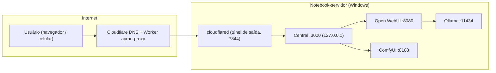

Nenhuma porta de entrada é aberta: tudo fica em `127.0.0.1` e o acesso externo é só pelo túnel de saída.

## 10. Estrutura de interfaces (skins)

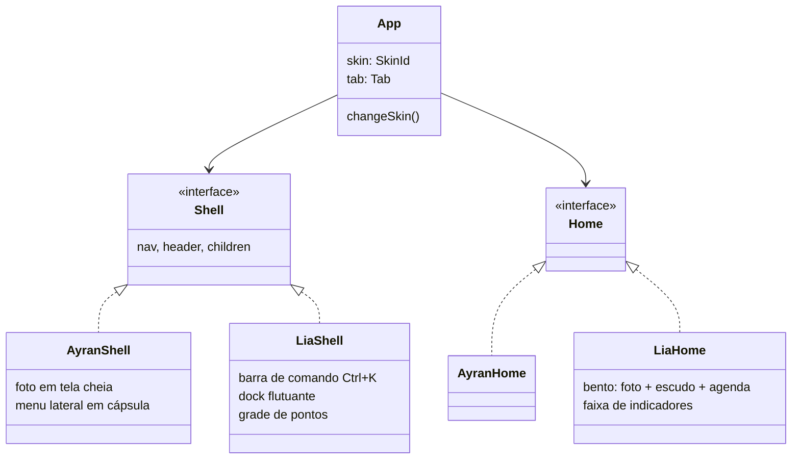

Para criar um modelo novo (ou um por cliente): pasta em `hub/frontend/src/skins/<nome>/` com `Shell` e `Home`, uma entrada em `skins/index.tsx` e outra em `lib/skin.ts`.

## 11. Princípios de usabilidade aplicados

| Princípio | Como aparece no produto |
| --- | --- |
| Visibilidade do estado | Carregando, vazio e erro em toda lista; "Ouvindo / Pensando / Falando" na voz; sino com contagem |
| Honestidade | Tudo que é demonstração leva a etiqueta "Exemplo" ou "Dados de exemplo" |
| Controle do usuário | Confirmação antes de apagar; "Mover para depois" em conflito de agenda; Esc fecha painéis |
| Reconhecimento, não memória | Atalhos na Home, dock/menu com ícones e nomes, filtros com contagem |
| Prevenção de erros | Fim antes do início bloqueado no formulário; links desativados em e-mail suspeito |
| Acessibilidade | Rótulos em campos, `aria-live` nos avisos, foco visível, não depende só de cor (ícone + texto) |
| Consistência | Cartões, chips e cabeçalhos únicos (`ui.tsx`); mesmos dados nas duas interfaces |
| Eficiência | Ctrl/⌘+K na Lia, criação rápida de tarefa na Home, voz em qualquer tela |
